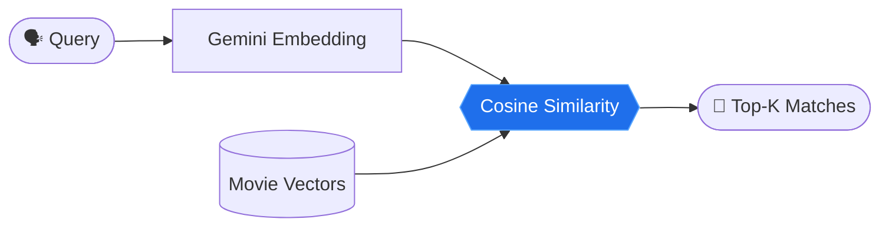
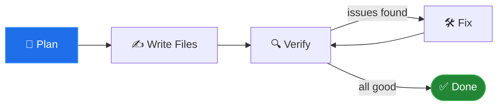
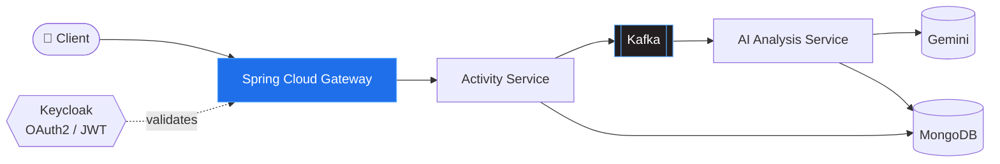

<div align="center">


<a href="https://git.io/typing-svg"></a>

<br/>


[](https://www.linkedin.com/in/yugansh-sharma-097740301/)
[](mailto:yugansh2511@gmail.com)
[](https://codolio.com/profile/Yugansh)
[](https://github.com/Yuganshhhh/Yuganshhhh/blob/main/yugGenAI-updated.pdf)

</div>

<br/>

## 〉 `cat about.java`

```java
public class Yugansh implements BackendEngineer, AppliedAIBuilder {

    String  role       = "Backend Engineer | Forward Deployed Engineer";
    String  education  = "B.Tech CSE (Final Year, 2026)";
    int     dsaSolved  = 400;   // and counting

    String[] currentlyBuilding = {
        "LLM-powered backends  -> Spring AI + Google Gemini",
        "Semantic search & recommenders -> vector embeddings",
        "System design & core CS fundamentals"
    };

    String[] askMeAbout = {
        "Spring Boot", "Spring AI", "RAG", "Embeddings", "AI Agents", "DSA"
    };

    boolean openToWork = true;  // Backend / FDE / SDE · Remote or Hybrid
}
```

<br/>

## 〉 `./tech-stack --list`

<div align="center">


</div>

<br/>

<table>
<tr>
<td width="33%" valign="top">

**⚙️ Backend**


</td>
<td width="33%" valign="top">

**🧠 Applied GenAI**


-0d1117?style=flat-square)

</td>
<td width="33%" valign="top">

**🗄️ Data & Tools**


</td>
</tr>
</table>

<br/>

## 〉 `./projects --featured`

<div align="center">

<a href="https://github.com/Yuganshhhh/movies-match-01"></a>
<a href="https://github.com/Yuganshhhh/ai-agent-01"></a>
<a href="https://github.com/Yuganshhhh/FitPilot"></a>

</div>

<br/>

<details open>
<summary><b>🎬 Movie Match</b> &nbsp;·&nbsp; Semantic Movie Search & Recommendations</summary>

<br/>


- Describe a movie in plain English → get the closest matches by **meaning**, not keywords
- Embeds the dataset on startup with `gemini-embedding-001`; ranks with **cosine similarity implemented from scratch**
- Two REST endpoints: semantic search and "movies similar to X"



[**→ View repo**](https://github.com/Yuganshhhh/movies-match-01)

</details>

<details open>
<summary><b>🤖 AI Agent Tools & Workflow Demo</b> &nbsp;·&nbsp; Autonomous website-generation agent</summary>

<br/>


- Builds complete multi-file sites (HTML/CSS/JS) through a **plan → write → verify → fix** loop
- Sandboxed file-system tools with **path boundary checks** to prevent traversal
- Streaming chat API (**SSE**) with multi-tool workflows: calculator, live weather & currency exchange
- Provider-agnostic LLM setup (Gemini via OpenAI-compatible endpoint)



[**→ View repo**](https://github.com/Yuganshhhh/ai-agent-01)

</details>

<details open>
<summary><b>🏋️ FitPilot</b> &nbsp;·&nbsp; AI-Powered Fitness Platform</summary>

<br/>


- Multi-service platform generating personalized workout analysis, improvement areas & safety guidelines with **Google Gemini**
- Decouples high-frequency activity ingestion from AI analysis using **Apache Kafka** event streaming
- Centralized auth: **Keycloak (OAuth2/JWT)** at Spring Cloud Gateway + automatic user provisioning
- Polyglot persistence: PostgreSQL for identities, MongoDB for activities & recommendations



[**→ View repo**](https://github.com/Yuganshhhh/FitPilot)

</details>

<details open>
<summary><b>🔗 AetherLink</b> &nbsp;·&nbsp; URL Shortener & Analytics</summary>

<br/>


- High-throughput 8-character slug generation with **HTTP 302** redirects and click-event tracking
- Stateless JWT auth via custom Spring Security filters + BCrypt + RBAC
- Containerized with Docker, deployed on Render with serverless PostgreSQL

[**→ View repo**](https://github.com/Yuganshhhh)

</details>

<br/>

## 〉 `./stats --live`

<div align="center">


<br/><br/>


<br/>


</div>

<br/>

## 〉 `./roadmap --current`

```diff
+ Shipping    LLM-powered backends with Spring AI + Gemini (RAG, tool calling, agents)
+ Exploring   MCP servers & multi-step agent workflows
+ Sharpening  System design · distributed systems · core CS
! Targeting   Backend / FDE / SDE roles · Remote or Hybrid · Class of 2026
```

<br/>

<div align="center">

### 📫 Let's build something

[](https://www.linkedin.com/in/yugansh-sharma-097740301/)
[](mailto:yugansh2511@gmail.com)
[](https://codolio.com/profile/Yugansh)
[](https://github.com/Yuganshhhh/Yuganshhhh/blob/main/yugGenAI-updated.pdf)

**Open to Backend / FDE / SDE roles · Remote or Hybrid · Graduating 2026**


</div>
